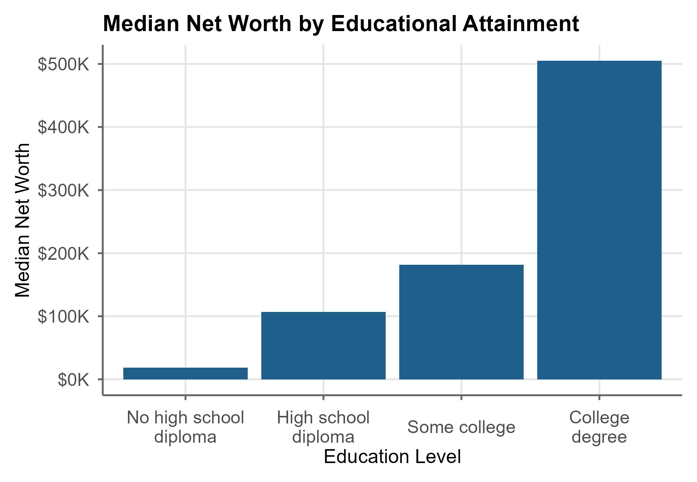

# Summary

The *Survey of Consumer Finances* (SCF) is a triennial national survey of U.S. households' income, assets, debts, financial behavior, and household organization [@Fed2023]. The data are used in academic research, Congressional research reports, and the production of official statistics. The data are high-quality and feature-rich, but its analysis is complicated by the Survey's complex design and its use of multiple imputation to impute missing data.

The R package `scf` [@Cohen2026a] provides a unified framework for acquiring, preparing, analyzing, and visualizing SCF public-use microdata. It encodes standard practices for handling the survey’s design, automates implicate-level estimation and pooling, and greatly reduces implementation complexity for common analytical tasks.

A detailed methodological description and validation against official Federal Reserve statistics is provided by @Cohen2026b.

# Statement of need

The valid analysis of SCF microdata requires a multi-step workflow that combines replicate-weighted survey estimation with the handling of multiply imputed datasets. Analysts must construct replicate-weighted survey designs for each implicate, estimate quantities separately across implicates, and combine results using appropriate pooling rules. 

In R, this workflow is typically implemented using Lumley's `survey` package [-@Lumley2026] together with the `mitools` package [@Lumley2019] or custom scripts. These tools are flexible and methodologically appropriate but require users to manually coordinate design specification, implicate iteration, and pooling. Consequently, even simple analyses require substantial custom code, and correct implementation depends on careful adherence to SCF-specific conventions. Reference workflows, such as those provided by Damico [-@Damico2026], demonstrate proper implementation but entail dozens of lines of code that can impede engagement by non-specialists.

The `scf` package addresses this gap by formalizing SCF-specific best practices within a standardized functional interface. It provides a unified data object that encodes the replicate-weighted design across implicates, together with functions that automate estimation and pooling. The package offers a consistent grammar and output format that substantially reduces custom code requirements for common analytical tasks. It reproduces official SCF statistics and reduces typical workflows from dozens of lines of custom code to a small number of standardized function calls [see @Cohen2026b].

# State of the field

There is no dedicated R package for analysing the SCF public-use microdata. At present, analyzing these data requires that the analyst craft custom scripts using a combination of generalist tools (e.g., `survey` and `mitools`) and reference documentation (publicly-distributed SAS scripts from the Federal Reserve or Damico's excellent code repository). These tools are more than sufficient for a seasoned survey data analyst with sufficient prior motivation to learn the SCF's idiosyncrasies. However, the task involves learning specialty branches of data analysis, learning the specificities of the SCF, and writing custom code. My experience is that this complexity can discourage competent generalist analysts with substantive interests in household finance from engaging the data. 

General survey tools could not absorb this work. The conventions that `scf` encodes belong to the SCF alone: its five-implicate file structure, the Federal Reserve's variance and percentile conventions, the constant-dollar base of its summary variables, and its codebook's variable definitions. These do not fit a general package such as `survey` [@Lumley2026] or its `dplyr`-style interface `srvyr` [@Ellis2024], which serve all complex surveys. `scf` therefore builds on `survey` rather than extending or replacing it.

The `scf` package addresses this gap by providing a standardized interface that encodes SCF-specific best practices and automates the most common analytical tasks. It reduces the barrier to entry for analysts with substantive interests in household finance who may not have prior experience with complex survey data or multiple imputation. The package is designed to be used by "intermediate" analysts who understand the basics of statistical inference, data wrangling, and regression modeling in R, but may not have specialized expertise in survey data analysis or multiple imputation. 

# Research impact statement

The package reproduces the Federal Reserve's published statistics. Using only `scf` functions, Tables 1 to 4 of the Fed's historical tables based on the public data [@Fed2026] were reproduced for all thirteen waves, 1989 to 2025: median and mean income and net worth, saving rates, and family shares by family characteristic, income shares by source, and reasons for saving. Of 5,839 published cells, 5,793 (99.2 percent) match within 0.1 percent for dollar figures and 0.05 percentage points for percentages. Most of the rest are medians and means near zero, where the Fed's rounding exceeds that tolerance, and income shares by source in 1989 and 1992. The report, with its code and cell-by-cell results, is in the `validation` folder of the package repository. @Cohen2026b describes the methods and an earlier validation against the 2022 tables.

The package has been on CRAN since October 2025 and was downloaded about 3,500 times from the Posit CRAN mirror in its first year. It is the analysis layer for the author's SCF research and for student research projects at Queens College, City University of New York.

# Software design

The package is designed around three core principles: rigor, accessibility, and transparency. It encodes SCF-specific survey and imputation workflows in a structured object while preserving access to implicate-level survey designs for advanced use cases.

A central design trade-off exists between convenience and transparency. A fully opaque interface would minimize code volume but obscure the underlying statistical operations. The approach adopted stores both pooled results and implicate-level estimates in every function's output, enabling analysts to inspect the underlying calculations rather than treating them as a black box.

Rather than implementing survey-statistical computations from scratch, `scf` builds on the `survey` package [@Lumley2026], the industry-standard package for complex survey analysis.

Where the Federal Reserve's practice differs from general survey practice, the package follows the Fed by default and offers the general method as an option:

- **Standard errors.** Sampling variance from the replicate weights and imputation variance across implicates are combined by Rubin's rules [@Rubin1987]. By default, the sampling variance comes from the first implicate, as in the Fed's own code [@Fed2023b]; the average over all five implicates, the usual practice in other software, is an option.
- **Percentiles.** Averaging the five implicate percentiles gives a standard error. Stacking the implicates and taking one weighted percentile reproduces the Fed's published tables. Both are available.
- **Dollars.** The Fed periodically restates the summary dollar variables of every wave in the dollars of its latest survey. Each data file records its dollar year, conversions between real and nominal dollars follow it, and loading files in different dollar years together gives a warning.

The package also stops, rather than pooling the rest, when a variable has missing values or an estimate fails in any implicate, so that problems surface instead of shifting results.

## Core object

The central object in the package is `scf_mi_survey`, a structured container representing one SCF wave. It stores the five imputed data sets with an associated `survey::svrepdesign` object, along with supplemental metadata. 

## Estimation workflow

Most `scf` functions follow a consistent internal pattern:

1. Construct or retrieve implicate-specific survey designs
2. Apply the corresponding estimation routine to each implicate
3. Combine results into a pooled estimate with associated uncertainty
4. Store combined and implicate-level results in an R list

Point estimates are averaged across implicates, and standard errors combine sampling and imputation variance as described above. This design yields a consistent user interface across common analytical tasks while automating imputation and replicate-weight handling.

## Functional coverage

The package supports end-to-end SCF workflows: downloading and loading the data, creating and subsetting variables, descriptive statistics, hypothesis tests, regression models, regression tables, and plots. The package documentation lists the functions. They reduce code repetition in common SCF workflows while maintaining compatibility with Lumley's `survey` ecosystem [-@Lumley2026].

# Example

A typical workflow is concise:

```r
library(scf)

scf_download(2025)
scf2025 <- scf_load(2025)

scf_mean(scf2025, ~income)
```

```text
Multiply-Imputed, Replicate-Weighted Mean Estimate

 variable estimate       se      min      max    n
   income 144630.1 2425.448 142605.3 145659.3 4360
```

The estimate matches the Federal Reserve's published mean family income for 2025, \$144,630 [Table 1, @Fed2026].

Users can also transform variables and fit models within the same object framework:

```r
scf2025 <- scf_update(scf2025, senior = age >= 65)

fit <- scf_ols(scf2025, networth ~ senior)
scf_regtable(fit, digits = 3, output = "console")
```

```text
Term                           Model 1
(Intercept)  946674.290*** (32275.140)
seniorTRUE   959785.980*** (87946.196)
--------------------------------------
N                                 4360
R2                               0.003
AIC                             150521
```

This approach delegates design specification, implicate iteration, and pooling to the package, leaving substantive modeling decisions with the analyst.

Visualization capabilities are included:

```r
# Specify education as an ordered factor with meaningful labels
scf2025 <- scf_update(scf2025, edclF = factor(edcl,
                                              levels = 1:4,
                                              labels = c("<HS", "HS",
                                                         "Some college",
                                                         "College"),
                                              ordered = TRUE))

# Plot
library(scales)
library(ggplot2)

fig <- scf_plot_cbar(
  scf2025, ~networth, ~edclF,
  stat  = "median",
  method = "stack",
  title = "Median Net Worth by Educational Attainment",
  xlab  = "Education Level",
  ylab  = "Median Net Worth",
  fill  = "#1F5F8B",
  angle = 0,
  label_map = c(
    "<HS"          = "No high school\ndiploma",
    "HS"           = "High school\ndiploma",
    "Some college" = "Some college",
    "College"      = "College\ndegree"
  )
) +
  ggplot2::scale_y_continuous(
    labels = scales::label_dollar(scale = 1 / 1000, suffix = "K")
  )
```



With `method = "stack"`, the medians follow the Federal Reserve's method and match its published figures: \$18,700, \$106,710, \$181,500, and \$505,030 [Table 4, @Fed2026].


# Availability

`scf` is implemented entirely in R. It builds primarily on the `survey` package for complex-survey estimation and uses established CRAN infrastructure for data handling and graphics. 

The package is available on CRAN:

```r
install.packages("scf")
```

Source code, examples, and documentation are available at: https://github.com/jncohen/scf. The package is distributed under the MIT License.

# AI usage disclosure

Claude (Anthropic; versions 3.5–5.5), ChatGPT (OpenAI; GPT-4o), 
Gemini (Google; 2.0 Flash), and Copilot (Microsoft) were used as aids 
in coding, debugging, and drafting portions of the documentation and 
manuscript. Their use occurred within a human-directed workflow in which the author determined all substantive content and structure. AI-generated outputs were treated as provisional and subject to review and revision. The conceptual design, methodology, and implementation were developed by the author. The author has reviewed and validated all material and retains full responsibility for the work. Correctness was checked with the package's automated tests, against independent calculations with `survey` and `mitools`, and by reproducing the Federal Reserve's published tables (see the Research impact statement).

# Acknowledgments

The package builds on the `survey` package and publicly available SCF documentation and example workflows. The author received no external funding for this work.
